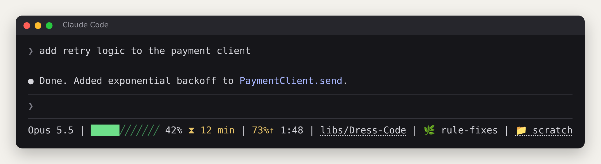
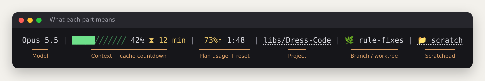
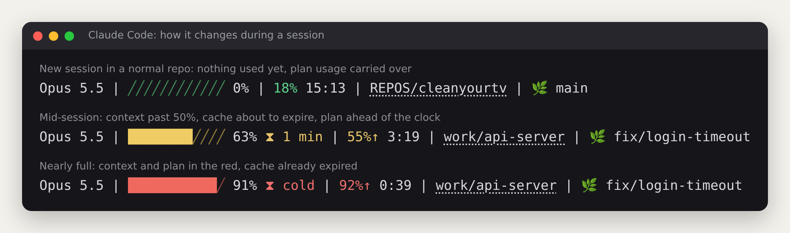

# Claude Code status line

A custom status line for [Claude Code](https://code.claude.com) that shows, at a glance, what the default one hides: how full your context is, when the prompt cache expires, and how fast you're using your plan.



There are two versions with the same features:

| Platform | Script | Needs |
|---|---|---|
| Linux (and probably macOS) | `linux/statusline.py` | Python 3 (standard library only) |
| Windows 11 | `windows/statusline.ps1` | Nothing extra: PowerShell is built in |

## What each part shows



| Segment | What it tells you |
|---|---|
| **Model** | Which model is answering right now. |
| **Context bar** | How full the context window is. Green under 50%, yellow under 80%, then red. When it fills up, Claude starts losing details. |
| **Cache countdown** `⧗` | Time until the prompt cache expires. After that, your next message costs many times more. Shows `cold` once it has expired, and stays hidden when little is cached. |
| **Plan usage** | Whichever limit (5-hour or 7-day) is closest to full, plus the time until it resets. `↑` means you're using it faster than time is passing. Remembered between sessions, so it shows before your first message. |
| **Project** | The last two folders of the project path. Click it to open the folder. |
| **Branch / worktree** `🌿` | The worktree name in a linked git worktree, otherwise the current branch. Hidden outside git. |
| **Scratchpad** `📁` | Claude's working files, or a `scratch/` folder in the project. Shown only when it has files in it. Click to open. |

## How it changes during a session



## Install

### Linux

```bash
bash linux/install-statusline.sh
```

Then use `/restart` in Claude Code.

### Windows 11

In PowerShell (Windows Terminal is recommended so the symbols render):

```powershell
powershell -ExecutionPolicy Bypass -File .\windows\install-statusline.ps1
```

Then use `/restart` in Claude Code. `-ExecutionPolicy Bypass` only applies to that one run.

### What the installers do

- Copy the script into `~/.claude/` (`%USERPROFILE%\.claude\` on Windows).
- Back up `settings.json` to `settings.json.bak-<date>`, then add the `statusLine` setting and keep all your other settings.
- Stop without changing anything if `settings.json` isn't valid JSON.
- Print a sample line with made-up data, so you can check colors and symbols in your terminal right away.

The installers carry their own copy of the script, so each one works on its own. If you edit `statusline.py` or `statusline.ps1` in this repo, re-run the installer or copy the file into `~/.claude/` yourself.

### Manual install

Copy the script into `~/.claude/` and add this to `~/.claude/settings.json`:

**Linux**

```json
{
  "statusLine": {
    "type": "command",
    "command": "python3 ~/.claude/statusline.py",
    "refreshInterval": 30
  }
}
```

**Windows** (use your own user name, with forward slashes)

```json
{
  "statusLine": {
    "type": "command",
    "command": "powershell.exe -NoProfile -ExecutionPolicy Bypass -File \"C:/Users/<you>/.claude/statusline.ps1\"",
    "refreshInterval": 30
  }
}
```

`refreshInterval` is in seconds. Without it, the cache countdown freezes while you're idle.

## Customize

The settings are at the top of each script:

| Setting | Default | What it does |
|---|---|---|
| `BAR_WIDTH` / `$BarWidth` | 12 | Width of the context bar. |
| `MAX_BRANCH` / `$MaxBranch` | 40 | Longer branch names are cut with `…`. |
| `MIN_CACHE_TOKENS` / `$MinCacheTokens` | 10,000 | The countdown is hidden below this many cached tokens. |
| `AHEAD_MARGIN` / `$AheadMargin` | 3 | How many points ahead of the clock before `↑` appears. |
| `SCRATCH_DIRS` / `$ScratchDirs` | `scratch`, `.scratch` | Project folders treated as the scratchpad. |

Colors are defined just below the settings.

## Uninstall

Remove the `statusLine` block from `~/.claude/settings.json` (or restore a `settings.json.bak-*` backup), then delete `~/.claude/statusline.py` or `statusline.ps1` and `~/.claude/statusline-limits.json`.

## Notes and limits

- **Plan usage** only comes with a Claude subscription (Pro or Max), not an API key. Claude Code sends it after the first reply of a session; until then, the last saved value is shown.
- **The cache countdown is an estimate.** Claude Code doesn't report when the cache expires, so the script reads the session transcript for the time of the last reply and whether the cache lasts 5 minutes or 1 hour. The transcript format isn't a documented interface and could change.
- **The scratchpad location** of Claude's own working files is a best guess, especially on Windows. The project `scratch/` folders always work.
- **Clickable links** need a terminal that supports them (most modern ones do, including Windows Terminal).
- **Testing:** the Linux version has been run in real Claude Code sessions. The Windows version is a straight port that hasn't been run on Windows yet. If it shows `statusline error: …`, that message says what failed.
- The images in this README were rendered from the Linux script's real output, using sample session data.
